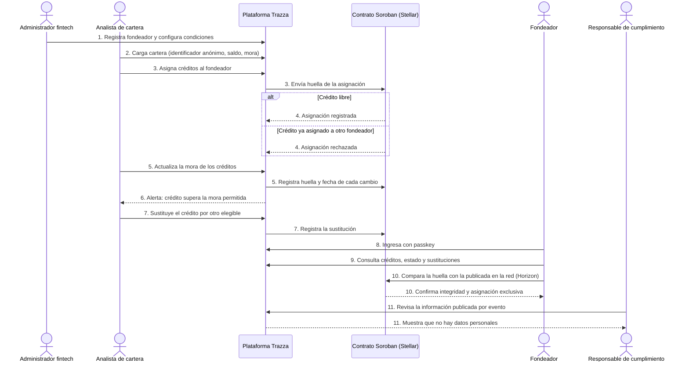
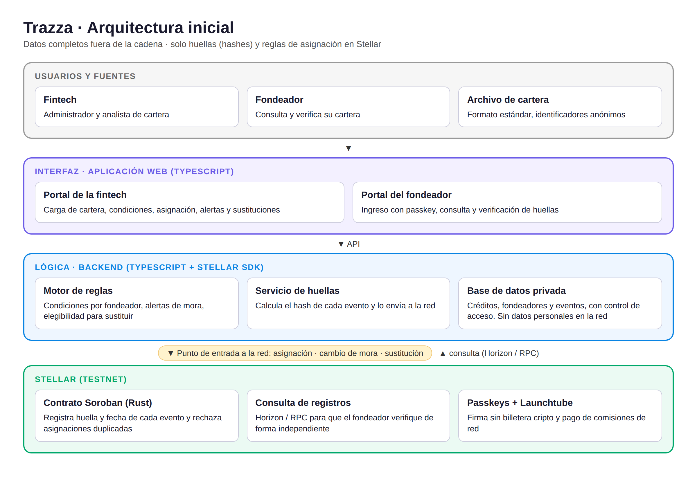

# Product Blueprint

**Nombre del proyecto:** Trazza

**Repositorio (enlace obligatorio):** [Trazza](https://github.com/Cearjeyou/Trazza)

> Los campos marcados como *enlace obligatorio* deben ir como enlace en Markdown, con este formato: `[texto del enlace](https://...)`. Reemplacen el texto y la dirección de ejemplo.

---

## Contenido

1. Priorización de historias
2. Propuesta de valor
3. Flujo de usuario
4. Alcance del MVP
5. Lean Canvas
6. Backlog priorizado (Kanban)
7. Arquitectura inicial
8. Uso de Stellar y justificación

---

## 1. Priorización de historias

> Historias elegidas entre las que propuso el equipo y criterio con que se priorizaron. Son las que pasan al backlog. Extensión: breve.

**Criterio de priorización:** MoSCoW, según qué tan directamente cada historia permite validar la hipótesis (registro verificable de asignaciones y prevención del doble fondeo):
- **Imprescindible:** sin ella no se puede probar la hipótesis.
- **Debería:** aporta valor importante al flujo, pero el MVP podría funcionar sin ella.
- **Podría:** mejora la experiencia o amplía el alcance; se incluye si hay tiempo.
- **Queda fuera:** valiosa, pero no necesaria para esta etapa.

| Prioridad | Historia | Propuesta por | Por qué entra al backlog |
| :---: | --- | :---: | --- |
| 1 | Como **analista de cartera de la fintech** quiero **cargar la cartera desde un archivo en formato estándar** para **tener los créditos disponibles para asignar a los fondeadores**. | Carlos Arturo Bermudez Rios | **Imprescindible.** Es el punto de partida del flujo: sin créditos cargados no hay asignaciones que registrar. |
| 2 | Como **analista de cartera de la fintech** quiero **asignar créditos a un fondeador y que quede registrada la asignación** para **demostrar a qué fondeador pertenece cada crédito**. | Carlos Arturo Bermudez Rios | **Imprescindible.** Es la base del producto: sin el registro de asignaciones no hay nada que verificar. |
| 3 | Como **fondeador** quiero **confirmar que un crédito asignado a mí no está asignado a otro fondeador** para **evitar el doble fondeo**. | Carlos Arturo Bermudez Rios | **Imprescindible.** Responde a una de las dos fricciones priorizadas y es donde el registro compartido aporta un valor propio. |
| 4 | Como **fondeador** quiero **comparar la huella de un registro con la publicada en la red** para **confirmar que la información no fue modificada después de registrada**. | Carlos Arturo Bermudez Rios | **Imprescindible.** Es la prueba central de la hipótesis de verificación independiente. |
| 5 | Como **administrador de la fintech** quiero **configurar las condiciones de cada fondeador (mora máxima, límites de concentración y plazo de sustitución)** para **que la plataforma controle su cumplimiento**. | Carlos Arturo Bermudez Rios | **Debería.** Permite controlar el cumplimiento; las alertas y sustituciones dependen de ella. |
| 6 | Como **analista de cartera de la fintech** quiero **recibir una alerta cuando un crédito supere la mora permitida por un fondeador** para **sustituirlo dentro del plazo acordado**. | Carlos Arturo Bermudez Rios | **Debería.** Cubre la situación más frecuente que activa una sustitución. |
| 7 | Como **fondeador** quiero **consultar el historial de sustituciones con su fecha y motivo** para **comprobar que se hicieron dentro del plazo acordado**. | Carlos Arturo Bermudez Rios | **Debería.** Hace verificables las sustituciones y reduce disputas. |
| 8 | Como **fondeador** quiero **ver en qué créditos está mi dinero y su estado actual** para **conocer la situación de mi inversión en cualquier momento**. | Carlos Arturo Bermudez Rios | **Debería.** Es el punto de entrada del fondeador al portal, donde realiza las verificaciones de las historias 3, 4 y 7. |
| 9 | Como **responsable de cumplimiento de la fintech** quiero **revisar qué información se publica en la red por cada evento** para **verificar que no incluya datos personales de los deudores**. | Carlos Arturo Bermudez Rios | **Podría.** Da confianza sobre la protección de datos desde el inicio. |

---

## 2. Propuesta de valor

> Qué resultado obtiene el usuario y por qué elegiría esta solución. En qué se diferencia de cómo resuelve hoy. Conecta con el usuario del Problem Brief. Extensión: 150–300 palabras en total.

**Usuario (del Problem Brief):** 
la fintech o cooperativa que origina créditos y necesita un mecanismo que dé validez a la información que entrega a sus fondeadores. Como usuario secundario, el fondeador que necesita verificar en qué créditos está su dinero y si se cumplen sus condiciones.

**Resultado que obtiene:** la fintech puede demostrar a qué fondeador pertenece cada crédito, cuándo un crédito entró en mora y cuándo se sustituyó, con un registro que nadie puede modificar después. El fondeador puede comprobar esa información por su cuenta y confirmar que un crédito asignado a él no está asignado a otro fondeador.

**Por qué elegiría esta solución:** 
- La fintech gana un respaldo verificable de su información, que puede ayudarle a generar confianza con fondeadores actuales y potenciales.
- El fondeador obtiene una forma de verificación que no depende únicamente de la palabra del originador.
- Ambas partes cuentan con una misma versión de los hechos, útil ante cualquier diferencia.
- No expone datos personales de los deudores: en la red solo se registran huellas de los eventos.

**En qué se diferencia de cómo lo resuelve hoy:** hoy el fondeador conoce el estado de su cartera por reportes de la fintech, por acceso a su sistema, por la fiduciaria o por auditorías, según cómo esté estructurado el fondeo. Trazza aporta dos capacidades específicas: comprobar que el historial de un crédito no fue corregido después de los hechos, y verificar que un crédito asignado a un fondeador no está asignado también a otro. Para ello, cada asignación, cambio de mora y sustitución queda fijado en el momento en que ocurre, en un registro que comparten todos los fondeadores de la fintech. El dato sigue siendo generado por la fintech, pero lo que declaró en cada momento ya no puede modificarse y la exclusividad de cada asignación es verificable.

---

## 3. Flujo de usuario

> Recorrido de la persona por la solución de principio a fin, roles y puntos de interacción. Diagrama o secuencia numerada. Extensión: 150–300 palabras.

| Paso | Rol | Qué hace | Punto de interacción |
| :---: | :---: | --- | --- |
| 1 | Administrador de la fintech | Registra a un fondeador y configura sus condiciones: mora máxima, límites de concentración y plazo de sustitución. | Pantalla de configuración (portal web) |
| 2 | Analista de cartera | Carga la cartera de créditos con sus datos básicos (identificador anónimo, saldo, días de mora). | Pantalla de carga de cartera (archivo en formato estándar) |
| 3 | Analista de cartera | Asigna créditos al fondeador. La plataforma calcula la huella de cada asignación y la envía a la red. | Pantalla de asignación → contrato en Soroban |
| 4 | Contrato en Soroban | Registra la asignación y la rechaza si el crédito ya está asignado a otro fondeador. | Red Stellar |
| 5 | Analista de cartera | Actualiza la mora de los créditos. Cada cambio queda registrado con su huella y fecha. | Pantalla de carga de cartera → red Stellar |
| 6 | Analista de cartera | Recibe una alerta cuando un crédito supera la mora permitida por su fondeador. | Panel de alertas |
| 7 | Analista de cartera | Sustituye el crédito por otro que cumpla las condiciones. La sustitución queda registrada en la red. | Pantalla de sustitución → contrato en Soroban |
| 8 | Fondeador | Ingresa al portal con su passkey (huella o reconocimiento facial), sin necesidad de billetera cripto. | Portal del fondeador + passkey |
| 9 | Fondeador | Consulta en qué créditos está su dinero, su estado y el historial de sustituciones. | Portal del fondeador |
| 10 | Fondeador | Verifica que un registro no fue modificado, comparando su huella con la publicada en la red, y confirma que el crédito está asignado solo a él. | Portal del fondeador → consulta a la red (Horizon) |
| 11 | Responsable de cumplimiento | Revisa qué información se publica en la red por cada evento para confirmar que no incluye datos personales. | Pantalla de auditoría de eventos |

---

## 4. Alcance del MVP

> Funcionalidad central separada de la deseable que queda fuera. Justificación de por qué el recorte sigue entregando valor. Extensión: 150–300 palabras en total.

| Dentro del MVP (funcionalidad central) | Fuera del MVP (deseable, para después) |
| --- | --- |
| Carga de cartera mediante archivo en formato estándar, con identificadores anónimos. | Conexión directa con el sistema de cartera de la fintech. |
| Configuración de las condiciones de cada fondeador (mora máxima, límites de concentración y plazo de sustitución). | Conciliación automática con los movimientos bancarios de recaudo. |
| Asignación de créditos a fondeadores, registrada en un contrato de Soroban que rechaza las asignaciones duplicadas. | Sugerencia automática de créditos elegibles para sustituir. |
| Registro en la red de cada cambio de mora y cada sustitución, con su fecha. | Historial verificable para compartir con fondeadores potenciales. |
| Alerta cuando un crédito supera la mora permitida. | Acceso para auditores externos. |
| Portal del fondeador con ingreso por passkey para consultar sus créditos, su estado y el historial de sustituciones. | Revisión de la información publicada por parte del responsable de cumplimiento. |
| Verificación de un registro comparando su huella con la publicada en la red. | |

**Por qué el recorte sigue entregando valor:** el MVP conserva las dos capacidades que sostienen la hipótesis: que un crédito no pueda asignarse a más de un fondeador y que el fondeador pueda verificar por su cuenta que el historial no fue modificado. También incluye el control de mora y el historial de sustituciones, que es la situación que más exige demostrar cumplimiento. Lo que queda fuera mejora la automatización (conexión con sistemas y bancos, sugerencias) o amplía los usuarios (auditores, fondeadores potenciales), pero no es necesario para comprobar si la verificación independiente aporta valor a fintechs y fondeadores.

---

## 5. Lean Canvas

> Lienzo de una página con el modelo del producto. Extensión: enlace (obligatorio).

**Enlace al Lean Canvas (obligatorio):** [Lean Canvas del proyecto](https://canva.link/9k51cy2ob3o25ey)

El lienzo debe cubrir: problema, segmento de usuarios, propuesta de valor única, solución, canales, métricas clave, ventaja diferencial y estructura de costos e ingresos.

---

## 6. Backlog priorizado (Kanban)

> Enlace al tablero en GitHub Projects, construido con las historias priorizadas, en columnas y con criterios de aceptación por tarjeta. Extensión: enlace al tablero (obligatorio).

**Enlace al tablero (obligatorio):** [Tablero Kanban en GitHub Projects](https://github.com/users/Cearjeyou/projects/3/views/1)

**Prioridad en el tablero:** P0 = imprescindible, P1 = debería, P2 = podría.

---

## 7. Arquitectura inicial

> Cómo se conectan las partes (interfaz, lógica, Stellar) y en qué punto entra la red. Diagrama simple en imagen. Extensión: 150–300 palabras en total.

**Diagrama (imagen o enlace):** 

| Capa | Componente | Qué hace |
| :---: | --- | --- |
| Interfaz | Aplicación web (TypeScript): portal de la fintech y portal del fondeador | La fintech carga la cartera, configura condiciones, asigna créditos, recibe alertas y registra sustituciones. El fondeador ingresa con passkey, consulta sus créditos y verifica las huellas. |
| Lógica | Backend (TypeScript + Stellar SDK): motor de reglas, servicio de huellas y base de datos privada | Aplica las condiciones de cada fondeador y genera alertas de mora. Calcula la huella (hash) de cada evento y la envía a la red. Guarda los datos completos con control de acceso, sin enviar datos personales a la cadena. |
| Stellar | Contrato Soroban (Rust), consultas por Horizon/RPC, passkeys y Launchtube | El contrato registra la huella y la fecha de cada evento y rechaza las asignaciones duplicadas. Las consultas permiten al fondeador verificar los registros de forma independiente. |

**En qué punto entra la red:** la red entra cuando ocurre uno de tres eventos: la asignación de un crédito a un fondeador, un cambio de mora o una sustitución. En ese momento, el backend calcula la huella del evento y la envía al contrato de Soroban, que la registra con su fecha y, en el caso de las asignaciones, verifica que el crédito no esté asignado a otro fondeador. La red vuelve a usarse cuando el fondeador verifica un registro: el portal consulta la huella publicada y la compara con la calculada a partir de los datos. El resto del flujo (carga de cartera, reglas y alertas) ocurre fuera de la cadena.

---

## 8. Uso de Stellar y justificación

> Qué componentes de Stellar usaría y por qué cada uno. Apoyado en el criterio de pertinencia del Problem Brief. Extensión: 150–300 palabras en total.

**Criterio de pertinencia (del Problem Brief):** varias partes que no confían entre sí (la fintech y sus fondeadores) necesitan compartir un mismo registro de qué crédito está asignado a quién, y el histórico de asignaciones, cambios de mora y sustituciones no debe poder alterarse después de registrado.

| Componente de Stellar | Para qué lo usamos | Por qué ese y no otra alternativa |
| --- | --- | --- |
| **Contrato inteligente en Soroban (Rust)** | Registrar la huella y la fecha de cada evento, y rechazar la asignación de un crédito que ya pertenece a otro fondeador. | La regla contra el doble fondeo queda en el contrato y ni la fintech ni Trazza pueden saltársela. En una base de datos propia, esa regla dependería de quien la administra. |
| **Stellar RPC / Horizon** | Consultar los registros publicados para que el fondeador compare las huellas. | Permite verificar directamente en la red pública, sin depender de los servidores de Trazza ni de la fintech. |
| **Stellar SDK (TypeScript)** | Conectar el backend con la red para enviar eventos y consultar registros. | Es la librería oficial y usa el mismo lenguaje del resto de la aplicación. |
| **Passkeys** | Permitir que el fondeador firme con huella o reconocimiento facial. | Los fondeadores no necesitan instalar ni manejar una billetera cripto como Freighter. |
| **Launchtube** | Enviar las transacciones y cubrir las comisiones de red. | Ni la fintech ni el fondeador necesitan tener XLM para pagar comisiones. |
| **Red de pruebas (testnet)** | Desarrollar y validar el MVP. | Permite probar sin costo real antes de pasar a la red principal. |
